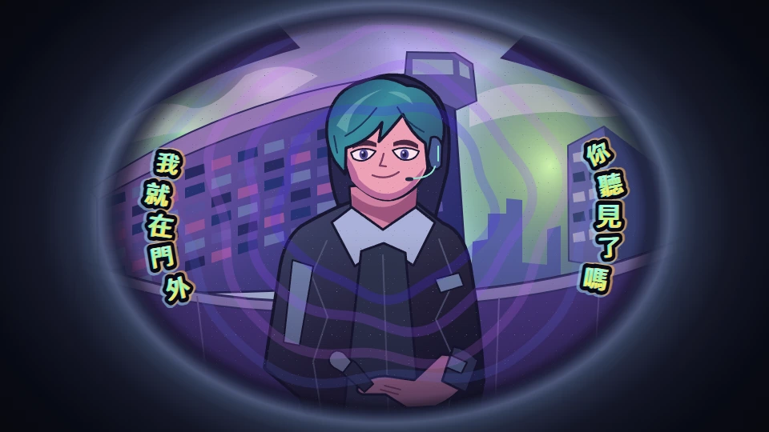
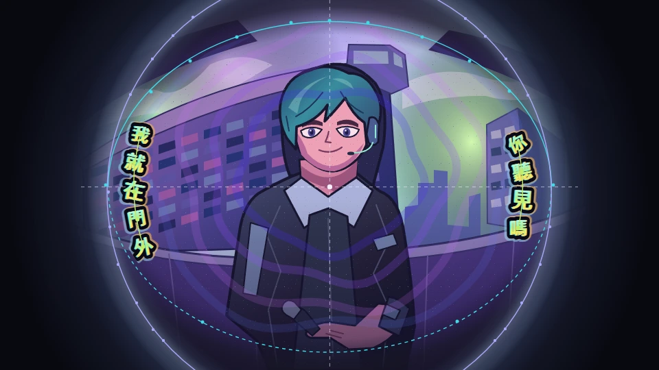

# 魚眼鏡筒

Working ID 為 `fisheye-lens`。2026-11-13 依使用者指定的 00:07 定格改稿。大門鏡置中，人物位於鏡心，歌詞沿鏡口左右內緣排成兩列。這版構圖取代首稿中央偏下的橫鏡與中央橫排字幕。採用狀態見[產品規格第 7.3 節](../../../spec.md#73-研究候選尚未接受為開發路線)。參見[候選索引](README.md)與[共用格式](proposal-template.md)。

## 意圖與參考

使用者於 2026-10-12 提出類似魚眼的變形視角，並於 2026-11-04、2026-11-13 重貼 DECO*27 的〈モニタリング feat. 初音ミク〉。11-13 續貼 00:07 截圖指定構圖。定格裡，門鏡外圈是厚而柔的藍黑暗角，人物正面居中，左右各有一串沿弧線排布的字。每字角度與尺寸略異，亮黃綠字面外有厚黑邊與青、琥珀色差。紫藍鏡面色光圍繞人物。參見[指定定格](https://www.youtube.com/watch?v=kbNdx0yqbZE&t=7s)與 [OTOIRO 發布紀錄](https://otoiro.co.jp/topics/104605/)。

## 定格構圖

樣張以 960 × 540 為比較畫布。可視孔徑置中，外圈暗角向四角延伸。字列沿左右獨立曲線排列，逐字依切線微調角度。人物面部在兩列之間保持完整，舞台以自製屋頂與人物示意作底圖。

| 群組 | 外觀                             | 堆疊與動作                                                   |
| ---- | -------------------------------- | ------------------------------------------------------------ |
| 底圖 | OBS 場景或樣張屋頂圖             | 由場景提供，樣張可切到透明棋盤檢查合成                       |
| 舞台 | 全幅藍黑厚暗角、可選紫藍色光     | 暗角固定，鏡心留空透出底圖。鏡面色光在字幕後方，樣張預設開啟 |
| 歌詞 | 黃綠字面、厚黑字邊、青與暖橙色差 | 同一字的描邊與色差跟字一起變形及換句，字列限制在鏡口內緣     |

## 歌詞與換句

- 當前句由右列讀到左列，各列從上往下。短句可只用右列。兩列皆沿鏡口弧線，字列的弧度與單字傾斜共同形成魚眼感。
- 長句樣張按逗號分為兩次顯示，每次仍使用同一對弧列。樣張時間為自製。正式長句的切分與出現時間需按來源能力驗證。
- 混語樣張將 `streetlights` 作為完整詞旋轉，與直排的中日文字共用鏡邊位置。樣張可直接跳選兩列、長句、混語、快句及間奏。
- 暫停保留當前畫格，拖曳依落點重建字形。快句與 reduced motion 可直接顯示定格。間奏留門鏡與色光。

### 停留期間的字形縮放

重看 07.000–07.750 的同一句弧列。07.125 右列首字比 07.375 大，07.625 又放大。同一時刻左右字的大小各有變化，字心大致留在原位。50.208–50.833 的粉紅字組則可見整組外框伸縮。參見[雙列停留](https://www.youtube.com/watch?v=kbNdx0yqbZE&t=7s)及[粉紅字組停留](https://www.youtube.com/watch?v=kbNdx0yqbZE&t=50s)。

樣張採 12 格一輪，約 0.5 秒。綠字以各自字心縮放，幅度約 ±7%，相鄰字與左右列錯開相位。粉紅字組以整組中心縮放約 ±4.5%，在展開與捲退邊界回到原比例，銜接已量測的外框。幅度與週期是依原片觀察選定的草稿值。字面顏色與描邊色維持固定，描邊跟著字等比縮放。暫停與拖曳重現當格尺寸，reduced motion 保留基準尺寸。

## 原片逐格量測

以 YouTube 暫停後的單格步進取樣，相鄰播放器位置約差 41.7 毫秒，以下以 24 格／秒換算。格數為可見畫格的間隔，畫面變化僅採取樣所見。樣張使用自製歌詞重現節奏，逐字先後與縮放曲線為草稿設定。

| 交接方式                                                               | 原片可見畫格                                                                                                                                                           | 樣張用法                                                             |
| ---------------------------------------------------------------------- | ---------------------------------------------------------------------------------------------------------------------------------------------------------------------- | -------------------------------------------------------------------- |
| [雙列逐字縮退、彈入](https://www.youtube.com/watch?v=kbNdx0yqbZE&t=7s) | 07.792 雙列完整，07.917 多字已縮小，08.042 仍有最後一字，08.083、08.125 空鏡。08.167 下一句先出現小字，08.417 雙列已排穩。由最後完整到全空約 7 格，先露字到排穩約 6 格 | 字各自縮到原位消失，空 2 格，新句錯開放大                            |
| [雙列縮退，單側接句](https://www.youtube.com/watch?v=kbNdx0yqbZE&t=5s) | 05.333 已有字縮小，05.500、05.542 雙列皆空。05.583 右列先露出三個小字，05.667 右列六字都可見，05.833 右列定格。右列首字到定格約 6 格                                   | 沿用逐字縮放，下一句只佔右側，左側留空                               |
| [隨鏡頭硬切](https://www.youtube.com/watch?v=kbNdx0yqbZE&t=6s)         | 06.000 仍有右列，06.167 已黑切，06.250 已出現插入鏡頭。06.792 黑場，06.833 回到門鏡時雙列同格完整。回切前後相隔 1 格                                                   | 保留樣張底圖，字幕整組切掉、整組回來。去程起點以已取樣的 06.167 示意 |
| [雙側煙團露字](https://www.youtube.com/watch?v=kbNdx0yqbZE&t=11s)      | 11.667 空鏡，11.708、11.750 兩側各一團，11.792 字已完整且煙團散成碎粒。12.292 尚有微粒，12.417 的取樣已無明顯碎粒，字仍留在原位                                        | 煙團維持 2 格，再露字。碎粒約半秒散開，位置限制在兩側                |

### 副歌旋轉補測

同一次換句中，左下粉紅字組與右側綠字走不同的路徑。以 24 格／秒逐格比較字組位置與輪廓，時間為播放器位置。樣張可單獨播放兩側手法，轉角、壓扁量與扭曲曲線為依畫面調整的草稿值。

| 交接方式                                                                | 原片可見畫格                                                                                                                                                            | 樣張用法                                                                                   |
| ----------------------------------------------------------------------- | ----------------------------------------------------------------------------------------------------------------------------------------------------------------------- | ------------------------------------------------------------------------------------------ |
| [字組旋渦展開、捲退](https://www.youtube.com/watch?v=kbNdx0yqbZE&t=50s) | 50.000 左下仍空，50.042 附近已出現大旋渦，50.208 完整可讀。50.958 字組先撐寬，51.000 仍寬，51.042 左右收窄，51.083 是最後一格旋渦輪廓，51.125 整組切掉                  | 固定左下支點，入場鬆開字形，退場先撐寬，再橫向收束並保留大部分高度。兩段各自調整輪廓與旋向 |
| [沿鏡弧轉出、翻入](https://www.youtube.com/watch?v=kbNdx0yqbZE&t=51s)   | 50.875 右列在原位，50.917 已往右下移，51.083 仍見下緣殘字，51.125 全空。從首見移動至全空相隔 5 格。51.375 新字成薄片出現，51.458 已部分翻正，51.625 已回正面，相隔 6 格 | 舊句各字保持順序，沿鏡弧下轉並被鏡口裁掉。新字沿弧移入，同時由薄片展開到原字比例           |

將 50.917 的可讀字組寬度視為 100%。在 873 × 491 的播放器畫面以可見外框估讀，50.958、51.000、51.042、51.083 的寬度約為 109%、107%、88%、66%。最後一格高度約保留 94%。這些比例用來調整樣張各格的外框，取樣誤差包含描邊、抗鋸齒及播放器遮擋。

沿弧樣張加快到 3 格轉出、空鏡 2 格、3 格翻正。在 24 格／秒下，從首格轉動到新句翻正約 0.33 秒。原片時間保留在上表作為量測紀錄。

### 動態模糊比較

旋渦的粉紅填色和黑邊在變形途中仍可分辨，樣張保留清楚的捲曲輪廓。綠字高速沿弧時仍有可見描邊，原片畫格不足以判定實際快門或模糊參數。樣張預設關閉動態模糊，可在「沿弧翻轉」打開比較。模糊沿字的移動路徑向後延伸約 4–11 px，僅作用於高速畫格，當前字形保留清晰。定格、硬切、煙團、鏡框與人物保留原畫面。Reduced motion 直接顯示清楚的字幕。

## 00:07 門鏡拉線

將使用者提供的定格等比例換算到 960 × 540，座標原點在左上。原片比對模式可開關同一組基準線。孔徑下半因暗部與人物遮住部分邊界，以虛線標示擬合區段。

| 基準     | 量測方法                                                 | 樣張值                                                                                       |
| -------- | -------------------------------------------------------- | -------------------------------------------------------------------------------------------- |
| 可視孔徑 | 沿明景進入暗部的轉折取 13 點，擬合橢圓                   | 中心 `(480.4, 272.8)`，水平半徑 `322.9 px`，垂直半徑 `241.3 px`。取樣點最大徑向差約 `2.8 px` |
| 藍灰環脊 | 由左右可見的藍灰亮帶取 19 點，擬合圓。圓的上下緣伸出畫幅 | 圓心 `(479.6, 282.2)`，半徑 `323.6 px`。取樣點最大徑向差約 `2.0 px`                          |
| 左右字列 | 依原片五個左字與四個右字的外框中心，各擬合一條二次曲線   | 左列量測高度 `196–360 px`，右列 `209–333 px`。取樣點最大水平差約 `0.9 px`                    |

令 `u = (y - 270) / 100`。左列路徑為 `x = 194.859 - 0.268u + 17.850u²`，右列路徑為 `x = 761.319 + 1.642u - 19.035u²`。座標單位為 px。取樣點與殘差用於定位此張定格。其他鏡頭及正式底圖需各自驗證鏡域與字列適用範圍。

## 評估與驗收

第二套「貼近」布局依使用者提供的 Best Friend Remix 定格。近景的圓形鏡圈越過畫幅上下，左右字列更大，沿弧往兩側讓出中央人物。標準景別保留原有弧列。這輪由輸出模板提供鏡框與字幕布局，背景與人物由場景合成。參見[原片](https://www.youtube.com/watch?v=C-CYwNz3z8w)與 [OTOIRO 發布紀錄](https://otoiro.co.jp/topics/112507/)。

畫面輸出的魚眼鏡筒可在工作臺調整文字、鏡框、反光、進退場與字幕顆粒度。實曲預設顯示整句，沿弧進場，退場依歌曲段落選擇沿弧或漩渦。漩渦展收沿用上表的寬高曲線，並以實際文字的左右字列為旋轉範圍。模板庫和 Browser Source 共用 Canvas 繪製。上面的樣張是開發期間的量測紀錄，現在可從畫面輸出工作臺使用實曲驗證。版型、容量與資料邊界見[輸出外觀契約](../../../contracts/output-appearance.md#歌詞模板呈現)。

正式驗收要用實際攝影機或 VTuber 場景檢查主體留白、厚暗角、字幕裁切與實曲對時。
