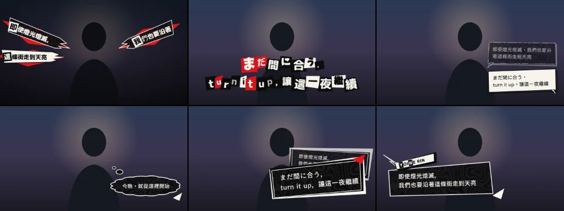
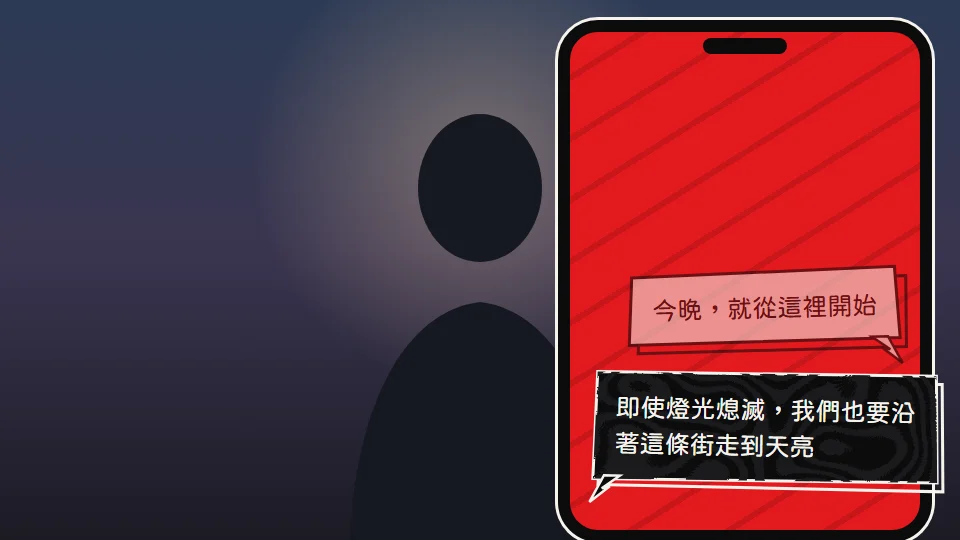
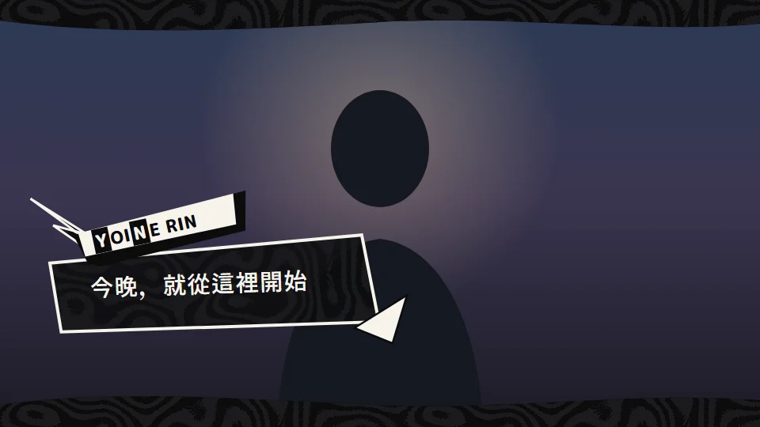
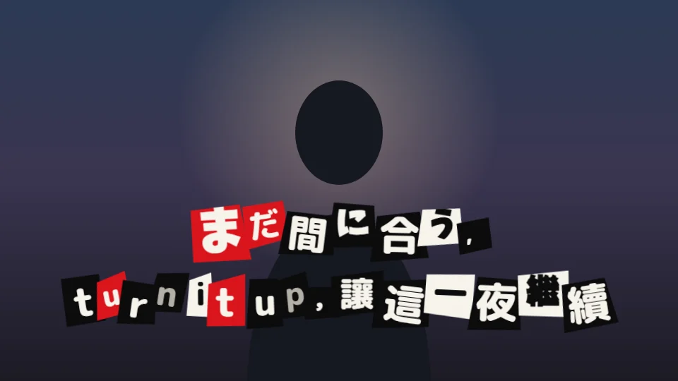
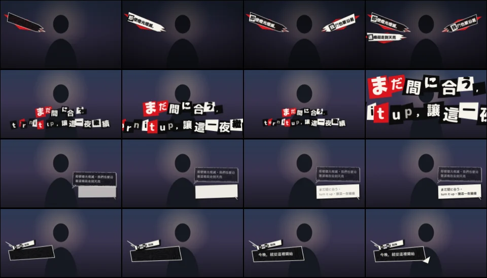

# 幻影怪盜

模板 ID 為 `phantom-thieves`。本文件保存早期的研究樣張與動態對照。現行行為見[外觀契約](../../../contracts/output-appearance.md#幻影怪盜)，採用狀態見[產品規格](../../../spec.md#3-功能現況)。參見[候選索引](README.md)與[共用格式](proposal-template.md)。

## 意圖與參考

2026-10-12 08:03（Asia/Taipei），使用者以 Persona 5 的對話框提出本案，核心是讓當前歌詞像被選中的回答切入畫面。相對既有 `manga-frame` 的直式漫畫對話框，本案偏橫向卡片、紅黑白平面圖形與剪字拼貼。

| 日期       | 使用者補充的參考                                 | 用途                       |
| ---------- | ------------------------------------------------ | -------------------------- |
| 2026-11-17 | 拼貼標題框、扇形指令選單、斜條標語、白框對白帶   | 卡片外形與剪字手法         |
| 2026-11-18 | 放射指令選單、犯罪預告信、紅底聊天記錄、標題拼貼 | 四個呈現選項               |
| 2026-11-18 | 三支官方預告片，要求動態與靜態細節盡量貼近       | 動態時序、外形與材質的量測 |

參考圖與影片含原作角色、介面及人物照片，原檔與抽格只留在本機，不入 repo。樣張沿用時序、緩動、圖層先後與材質手法，輪廓、字形組合、文字與圖形皆為自製。參見[預告一](https://www.youtube.com/watch?v=wPqSkzNNPIg)、[預告二](https://www.youtube.com/watch?v=QnDzJ9KzuV4)及[預告三](https://www.youtube.com/watch?v=uopjveI_vc8)。

## 呈現選項

2026-11-18 使用者確認，呈現方式是模板的預設選項，依序排列由使用者選擇，不依段落自動切換。堆疊卡併入聊天，與泡泡、思考泡泡並列為聊天的三種外形。

| 順序 | 選項     | 構圖與行為                                                                                                                                  |
| ---- | -------- | ------------------------------------------------------------------------------------------------------------------------------------------- |
| 1    | 放射短句 | 句子在逗號處切成約 7 字以內的片語，最多 6 條。條帶尖端朝向人物，依 Z 字順序先左後右、由上而下。背景預設壓暗。最新一條為白底，較早的退回黑底 |
| 2    | 預告信   | 每字一塊不規則底板，紅、黑、白與灰字交錯，首字放大為紅底。最多兩行，置中於下方                                                              |
| 3    | 聊天     | 泡泡：新句從右側欄底部彈出，上一句往上推並變淡，左右交替白底與黑底。思考泡泡：置中的雲形黑底。堆疊卡：目前句在前，上一句退到後方            |
| 4    | 側邊彈卡 | 對話框式卡片，預設從左側中段彈出，上方名牌顯示歌手名。另可選置中或隨句換位                                                                  |

- 畫面同時最多兩句：聊天保留上一句，其他選項只顯示目前句。
- 放射短句只有行級時間時，片語在句子前段依序展開，每條間隔至多約 0.32 秒。有 T2 或 T1+ 時，可改成每條片語各自到點出現。
- 聊天可加手機外框，泡泡排在螢幕內。外框約佔畫面右側三分之一，預設關閉。

## 排版規則

2026-11-18 使用者確認，歌詞維持橫向，一句用一張卡或一組字。長句先加寬，不拆成畫面上的多張卡。同時出現三行就會影響排版，因此以兩行為上限。

- 超過單行上限時折成兩行，斷點優先選逗號，再選兩行最平均的位置。Latin 詞組不從中間斷開。
- 單行上限：側邊彈卡在左側時約 520–600 px，置中時約 680–760 px，預告信約 820 px。
- 兩行仍放不下時逐步縮字。放射片語從 34 px 縮到 22 px，卡片從 44 px 縮到 32 px。低於下限的分頁方式待定。
- 不改原文、ID 與來源時間，斷行只改呈現。

## 外觀與材質

2026-11-18 使用者指出風格已到位但靜態素材粗糙，依原尺寸畫面補足下列細節。

| 素材     | 原片觀察                                                                                                                                                                                                                                                                                                                                                           | 樣張做法                                                                                                                                                                                                                                                                                                                                                       |
| -------- | ------------------------------------------------------------------------------------------------------------------------------------------------------------------------------------------------------------------------------------------------------------------------------------------------------------------------------------------------------------------ | -------------------------------------------------------------------------------------------------------------------------------------------------------------------------------------------------------------------------------------------------------------------------------------------------------------------------------------------------------------- |
| 黑色面   | 半透明黑底帶暗灰等高線狀漩渦紋，框線細白                                                                                                                                                                                                                                                                                                                           | 共用 SVG 紋理，以分形雜訊分帶，濾鏡固定在 sRGB 計算。黑底約九成不透明                                                                                                                                                                                                                                                                                          |
| 外形     | 框、條帶與卡片的四邊不平行                                                                                                                                                                                                                                                                                                                                         | 所有框與條帶的頂點依固定亂數微移數 px                                                                                                                                                                                                                                                                                                                          |
| 對話框   | 正文為乾淨的白色粗字，不剪字。左上有閃電狀尾巴，名牌在框外上方，右下有白色三角                                                                                                                                                                                                                                                                                     | 正文不剪字。補閃電尾巴與壓在框角的三角                                                                                                                                                                                                                                                                                                                         |
| 名牌     | 白底斜卡疊在錯開的黑色鋸齒影子上，名字中有一兩個字母反白                                                                                                                                                                                                                                                                                                           | 顯示歌手名，第 1 和第 4 個字元反白。樣張以虛構名稱示範                                                                                                                                                                                                                                                                                                         |
| 外框層次 | 由外到內為黑帶、白線、框內黑底。黑帶約與白線同寬，名牌下方黑帶約為上方兩倍。白線粗細沿邊漸變，右緣上段 11 px、下段 7.6 px（1080p）。框與尾巴依 owner 提供的範例圖：梯形框（左側較矮、上緣往右上升、右緣外傾），左側尾巴是兩折外層鋸齒加一條內側折線，右下為四角白三角伸出框外。名牌英文為粗體。右下白三角伸出框外時，框的黑底跟著凸出成箭頭（1080p 約多 20–40 px） | 黑帶以外擴環繪製，寬度與位移由 CSS token 定義。白線依各角寬度內縮，輪廓、內側折線與白三角直接取自範例圖座標，以單行框高為比例；左側細節固定在左、右側細節跟右端，只有上方兩角跟上緣，歌詞變長或變高只拉長中段。純對話框以 `--phantom-side-card-tail-reach` 讓出尾巴空間。英文名改用內建的 M PLUS Rounded ExtraBold。白三角改純白，底下加外擴的黑箭頭並一起脈動 |
| 選項條   | 白條有粗黑邊，黑條有細白邊，尾端是指向說話者的多根尖刺                                                                                                                                                                                                                                                                                                             | 放射條帶採多尖刺尾巴，首字反白                                                                                                                                                                                                                                                                                                                                 |
| 跳字     | 每字墊著自己的斜黑塊，黑塊重疊成帶，字為白色或暖灰的圓潤粗體                                                                                                                                                                                                                                                                                                       | 預告信底板以不規則四邊形裁切並互相重疊，奇數字縮小、抬高，部分為灰字                                                                                                                                                                                                                                                                                           |
| 思考泡泡 | 雲形黑底，邊緣圓弧大小不一，白色細框，旁邊有兩個小雲                                                                                                                                                                                                                                                                                                               | 依橢圓產生大小不一的圓弧外框，附兩個小雲與白色三角                                                                                                                                                                                                                                                                                                             |
| 紅色面   | 紅色斬切面帶細網點                                                                                                                                                                                                                                                                                                                                                 | 紅色斬切片與飾塊改用斜向網點紋理                                                                                                                                                                                                                                                                                                                               |
| 畫面邊框 | 對話場景上下有帶漩渦紋的波浪黑邊                                                                                                                                                                                                                                                                                                                                   | 可選的上下黑邊，預設關閉，避免遮住 OBS 畫面                                                                                                                                                                                                                                                                                                                    |

側邊彈卡以日文圓黑體與英文粗襯線為參考。正文與姓名的字級依 Output 畫布寬度計算，再套用使用者的文字大小設定。正文保留歌詞語言，混排維持同一段文字以支援自然斷行。缺少語言線索時，以假名或韓文判斷日韓，純漢字依預設字型堆疊顯示。簡中、韓文及其他字系可用系統字型補足。姓名獨立排版，適合逐字裝飾的姓名才穿插怪盜字形。

## 動畫

依 [GSAP 動畫分工](../../../governance/output-gsap-migration-plan.md#動畫與繪製分工)，GSAP 只寫姿勢、時長、緩動與錯開。每句建一條暫停的時間軸，依歌詞時間連續取樣，暫停、拖曳與截圖因此落在同一姿勢。CSS 與 SVG 只持有版面和材質，不與 GSAP 控制同一屬性。

下表以 30 格／秒逐格量測原片，格數只當作姿勢的時間單位，不量化時間軸。預告二原為 60 fps，抽成 30 fps 比對。

| 參考片段                                                          | 原片可見畫格                                                                                                                                                                                                                                                                                                                                            | 樣張用法                                                                                                                                                                 |
| ----------------------------------------------------------------- | ------------------------------------------------------------------------------------------------------------------------------------------------------------------------------------------------------------------------------------------------------------------------------------------------------------------------------------------------------- | ------------------------------------------------------------------------------------------------------------------------------------------------------------------------ |
| [對話框進場](https://www.youtube.com/watch?v=uopjveI_vc8&t=206s)  | 206.87 與 212.6 兩次相同：第 0 格只有無字名牌，框依格為 0.57、0.84、0.84、1.02、1.00 倍，從尾巴尖端長出，黑底隨之加深。第 4 格名字硬切出現，正文約 4 格由暗轉亮。約第 8 格右下白色三角跳出，之後持續大小脈動                                                                                                                                            | 側邊彈卡依同一組逐格倍率補間，名牌領先一格，名字硬切、正文 4 格淡入，0.27 秒跳出三角                                                                                     |
| [對話框換句](https://www.youtube.com/watch?v=uopjveI_vc8&t=208s)  | 208.9 上一句與名字立即消失，框單格變形到新外形約 0.95 倍，接著 0.84 倍停兩格，第 3 格回到原尺寸，名字第 1 格出現                                                                                                                                                                                                                                        | 上一句結束即接下一句時框不重新進場，依 0.95、0.84、0.84、1.00 倍變形。彈卡依字寬收緊，正文延到第 3 格再顯示，避免超出縮小的框                                            |
| [對話框停留](https://www.youtube.com/watch?v=uopjveI_vc8&t=207s)  | 四周外框都在動，正文與名字不動。名牌白底右端與上下緣伸縮約 ±7 px，黑帶外緣不動，所以黑帶時寬時窄。尾巴尖端與鋸齒頂點移動約 ±5 px，白鋸齒線寬約 16–21 px 間變化，內側細鋸齒形狀也在變，每半圈 6–8.5 格。框線寬固定（逐格標準差 ≤0.2 px），框的四邊繞各自中點小幅轉動，角點約 ±0.3–1.7 px（上緣左端最大），約 16 格一圈，與名牌、尾巴不同相。幅度每圈不同 | 名牌白底向黑帶伸縮；尾巴尖端與齒移動、白線寬度呼吸、內側細鋸齒變形；框四角約 1 px 平移。三組各用固定亂數與自己的節奏由 GSAP 補間，正文與名字不動，暫停與拖曳落在同一姿勢 |
| [對話框退場](https://www.youtube.com/watch?v=uopjveI_vc8&t=251s)  | 251.45 框在單一格內消失                                                                                                                                                                                                                                                                                                                                 | 側邊彈卡以 1 格硬切退場                                                                                                                                                  |
| [思考泡泡](https://www.youtube.com/watch?v=uopjveI_vc8&t=251s)    | 251.78 先出現小尾巴，橢圓外框 4 格內長成雲形黑底，正文 3 格淡入。253.1 起約 6 格淡出，不縮放                                                                                                                                                                                                                                                            | 聊天的思考泡泡依此時序進退場                                                                                                                                             |
| [選項條](https://www.youtube.com/watch?v=uopjveI_vc8&t=74s)       | 74.17 背景壓暗。74.23 三條選項從說話者往外長出，每條錯開約 1 格，先是黑底白框，約第 4 格翻成白底黑字，之後輕微擺動                                                                                                                                                                                                                                      | 放射短句先壓暗，條帶 3 格長出後翻成白底露字。停留時以往返 tween 擺動約 ±1.4°                                                                                             |
| [跳字標語進場](https://www.youtube.com/watch?v=QnDzJ9KzuV4&t=66s) | 66.18 各字從四散位置飛入，約 6 格聚攏。接著 2 格放大到約 1.5 倍，下一格縮到約 0.85 倍，再 2 格定住                                                                                                                                                                                                                                                      | 預告信各字同時從四散位置聚攏，再依同一組倍率回彈                                                                                                                         |
| [跳字標語停留](https://www.youtube.com/watch?v=QnDzJ9KzuV4&t=66s) | 66.6–67.4 各字每 2 格小幅位移與轉動，整組位置不變                                                                                                                                                                                                                                                                                                       | 依固定亂數預算每 2 格一組姿勢（±2 px、±2°），由 GSAP 插值，抖動放在內層字塊                                                                                              |
| [跳字標語退場](https://www.youtube.com/watch?v=QnDzJ9KzuV4&t=67s) | 67.2 起約 8 格逐漸縮小，67.47 單格放大並往上衝出畫面，下一格消失                                                                                                                                                                                                                                                                                        | 只用在段落結尾那一句：先縮到 0.8 倍，再 1 格放大到 2.2 倍並上移後消失。其他句直接切換                                                                                    |
| [堆疊選單卡](https://www.youtube.com/watch?v=uopjveI_vc8&t=268s)  | 傾斜卡片依序由右滑入堆疊，後一張晚一點到位                                                                                                                                                                                                                                                                                                              | 聊天的堆疊卡由右滑入並略微回彈，上一張退到後方                                                                                                                           |

聊天泡泡沿用對話框的時序，3 格從尾端長出，字隨後淡入，間奏保留到下一句才往上推。側邊彈卡另保留 `slash-in`（斜切遮罩揭示，GSAP 補間 `clip-path`）與 `paper-snap`（放大回彈）兩種進場作對照。

暫停保留當前畫面，seek、換曲、重連與恢復時依當前資料落位。Reduced motion 不建立動畫，直接顯示定格。秒數與倍率皆為草稿值。

## 印刷色帶定格

2026-11-12 的 IMG_1833 提供另一種焦點做法。借用平直曲名帶的起線和黑白反相，與側邊彈卡並排比較。沿用 16:9 舞台及同一組自製歌詞，底圖、人物位置和字幕字高一致。 [演出印刷物風格提案](../performance-ephemera-proposal.md#5-output-歌詞印刷色帶)

- 首版固定於舞台下方一側，當前句用墨黑帶和暖白字，帶尾留一小截朱紅。紙帶寬度隨字區變化，端點可輕微錯位，文字保持同一水平起線。外圍透明。
- 長句沿自然語意折成兩行，兩行各用一條紙帶，起線對齊，末端各自收齊。日文與英文混排優先保留完整詞組。
- 換句先比靜態交接與整帶短促揭示。文字和色帶同步，短句一開始即可讀。
- 先比較固定左下與固定右下，再看明、暗和細節多的 OBS 場景。帶尾色可作獨立開關候選。

## 待決與驗收

- 選定四個選項中的開箱預設項，以及側邊彈卡的預設位置。
- 聊天左右交替的依據，是否接聲部或演唱者。
- 放射短句超過 6 條時的處理，以及人物中心是否可調。
- 預告信的配色比例與長句可讀性。
- 以長句、混語、缺字、明暗與複雜背景驗證排版及透明邊緣，連同快速換句、seek、reduced motion 與 OBS alpha 一起驗收。
