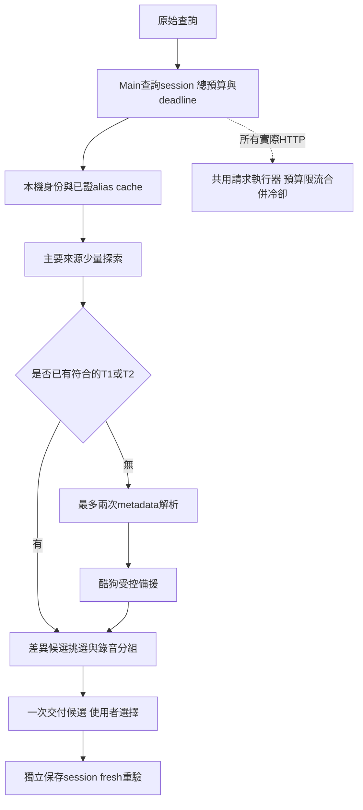

# 歌詞查詢預算與跨語別名改善方案

日期：2026-10-31。優先讓Hana No Uta／Aimer這類原始輸入自動取得可驗證的原文別名，並讓首次搜尋的總請求與等待時間可控。建議採用Main查詢session、來源共用請求執行器、獨立身份證據解析器與分離的provider adapter，分階段整理。AMLL provider與其可執行研究入口應完全移除；Better Lyrics仍需的TTML能力先抽到中立模組。此為提案及隔離可行性驗證，未改正式查詢程式、未commit。

## 已確認的缺口

目前只有各provider預算，沒有整合搜尋總預算；首次三個主要來源合計最多9次HTTP，再加酷狗5次可到14次；擴搜可到21次。主要來源25秒與酷狗25秒串接，名義等待可累加約50秒。

候選搜尋、hydration、cache與保存重驗由各adapter自行編排，整合層只能等待每個provider完整回應，不能替跨語解析和備援保留額度。Kugou的純identity模組可接受明示aliases，但正式acquisition的inputFor只從本次title／artist／duration建立reference，沒有跨provider別名證據管線；直接把搜尋字串改成日文也會丟失原始身份與保存重驗脈絡。

既有musicIdentity profiles已能攜帶alias kind／source／confidence，但缺少同錄音的alias evidence取得與逐筆保存路徑。MusicBrainz現有client只查recording欄位，正規化recording時也不保留aliases、disambiguation、video等這次需要的證據。官方搜尋支援獨立alias欄位；然而本輪原title查詢及recording OR alias查詢都為200零結果，work alias查詢為503後停止。不能把改MusicBrainz查法當成Hana No Uta已解決。

AMLL早已不在正式manual／automatic registry，因此移除AMLL不會直接節省目前首查HTTP。剩餘負擔在runtime storage／candidate／刪除相容、Better借用的TTML parser、renderer標籤，以及仍可被研究registry建立的AMLL探針。

## 原始輸入的自動別名驗證

Apple官方Search API可依文字搜尋、依ID lookup，並提供country、trackId、artistId及時長。官方說明約20 calls/min且可能改變，並建議cache；提案採更保守的每3.1秒啟動一次、全App共用，不取得任何preview／artwork／歌詞媒體。[Apple官方API](https://performance-partners.apple.com/search-api)

本輪隔離鏈僅以Hana No Uta／Aimer／371秒、album未知、studio為輸入，沒有在探索程式寫入花の唄：

1. US搜尋Hana No Uta Aimer，限定song、最多5筆。先以原title完全匹配、完整歌手及時長差≤4秒篩選，排除Live與end of spring version。
2. 對符合的最多3個track id一次性JP lookup。只有同trackId、同artistId、相同時長及相容完整credit的跨商店回應才建立alias關係；不靠結果排名猜翻譯。
3. 三個ID在US為Hana No Uta，在JP同為花の唄，時長分別373427、371427、371920ms，對應artistId均569972619。這是三筆目錄映射，不等於三個獨立歌詞版本，也不能取第一筆覆寫本機專輯。
4. 自動把取得的alias提供給既有嚴格Kugou研究探針：原查詢miss，native alias查詢取得花の唄／Aimer／373秒、64時間行、offset 0的T1候選，matchBand strong，reviewVerdict仍為unreviewed。

2026-10-31 05:58:28～05:58:34（Asia/Taipei）完成的完整鏈為6次HTTP／6375ms：Apple搜尋與JP lookup各一次，Kugou原查詢一次、alias目錄一次、歌詞候選與下載各一次。Apple兩次起點間隔3112ms；酷狗起點間隔至少1000ms。這是未接正式流程的單例候選取得證據，沒有重測當時三個主要來源或播放同步，不能當整體首次成功率或六秒SLA。

研究中另核對過US lookup切ja_jp仍回羅馬字，不能把lang參數當成一定能拿原文。完整鏈第一次因探針reference缺必填album:null而在發酷狗請求前被拒，保留失敗；補齊結構後原身份不變再驗。腳本實驗共14次HTTP（13次200、1次MusicBrainz 503），只保留有界metadata及結果摘要，沒有保存歌詞。原始與成功收據分開存於ignored tasks。

## 跨語解析的正式邊界

新增lyrics identity resolver，沿既有musicIdentity profile，不建立全域歌曲譯名字典。先讀本機明示／已確認alias及cache；不足時，第一次只選一個metadata路徑，最多2次HTTP。Hana類輸入優先採本次驗證的US搜尋→同ID JP lookup，不輪詢多國商店。其他語系或查無資料時安靜返回缺乏別名證據，不能以機器翻譯或搜索排名補成高信心。MusicBrainz可作有既有MBID／ISRC時的可選resolver，沿全App1.1秒scheduler及官方1 request/sec要求，不疊加成每次首查都做第二套metadata搜索。[MusicBrainz官方API](https://musicbrainz.org/doc/MusicBrainz_API)、[搜尋欄位](https://musicbrainz.org/doc/MusicBrainz_API/Search#Recording)

身份保持兩份：original identity是使用者原字串與完整credit／duration／version；verified aliases只補充可用名稱，不覆寫原身份。每條evidence含來源、track或recording id、artist id、原名／別名、duration、version、storefront、取得時間與policy version。探索query可挑最有用的已證別名，但候選與保存都要回到同一份原身份及證據重新核對。原始title輸入不要求使用者修改，Renderer也不能提交任意alias／外部id當信任來源。

同Apple track id只證明該目錄的跨語名稱對應，不能單獨證明Kugou為同音訊或同步正確；跨provider仍查全部歌手／feat、版本及時長，並核LRC ti／ar。複合歌手只有primary artistId一致不夠，必須有完整credited text相容；資料缺少合作署名時不得自動建立可信別名。work alias只證明作品名，不能把live／cover／movie edit變studio。

初版維持原4秒duration窗、不移除live／remix／cover／instrumental／movie／edit等版本。發現多個不同原文、矛盾credit或不同版本時，不靜默選最高score；只呈現可供確認的身份選項，未確認不繼續用其別名取歌詞。

## 整體預算與等待時間提案

所有數字為新的建議設定，尚未生效。父session從Main接受已通過gate的搜尋意圖起計時；metadata、原查詢、備援、hydration及短重試全算同一份實際HTTP預算。各來源原有間隔與個別上限仍生效，不能因父預算較大而提高來源流量。

| 意圖       | 整體HTTP上限        | 整體deadline | 完成條件                               |
| ---------- | ------------------- | ------------ | -------------------------------------- |
| 首次搜尋   | 12                  | 20秒         | 約3個真實可用候選，或時間／HTTP耗盡    |
| 明確找更多 | 8個新增HTTP         | 15秒         | 保留原候選，最多再增加3個有差異候選    |
| 手動保存   | 3                   | 12秒         | 只重驗所選provider，禁止整合fan-out    |
| 背景取得   | 維持獨立背景session | 與互動隔離   | 只LRCLIB／NetEase，不附帶alias網路解析 |

首查先保留最多4次給主要來源（LRCLIB一次、NetEase搜尋＋一筆detail、Better一次），最多2次給身份解析，至少3次保障Kugou完成目錄→候選→下載、Kugou仍最多5次，另有1次機動額度；最大分配4＋2＋5＋1＝12，不預設全用完。互動首輪503不自動原地重試，將額度留給其他來源；所有實際重試仍必須經父預算。

階段時間參考為主要來源6秒、需要時alias解析6秒、備援8秒；父20秒永遠是上限，前段早完成可把剩餘時間留給下一階段。每個request的deadline為父、子階段與來源timeout的最小值，排程等待及body也算。來源慢會使20秒內無法取得完整候選，屆時回傳保留的partial與明確原因，不偷偷延長或在背景續查。健康環境的首次可用候選目標為12～15秒內，待固定cold cohort量測，不把單次6.4秒當保證。

純文字T0保留在列表；如果目標是同步歌詞且尚無T1／T2，允許在父預算內進備援，避免目前T0阻止酷狗的情況。已有合適T1／T2且仍有不足三個選擇時，先從已回來的metadata／其他主要來源補差異候選，不另啟動酷狗湊數。漸進顯示仍不做，停止不必要等待後一次交付快照。

## 查詢執行器與provider分工

建議結構如下；重用現有已驗證的requestPolicy與scheduler，不一次重寫所有client。

| 模組              | 責任                                                                           | 不應持有                               |
| ----------------- | ------------------------------------------------------------------------------ | -------------------------------------- |
| query session     | original identity、階段、父預算、剩餘時間、取消／世代                          | HTTP route、上游body                   |
| identity resolver | 已證alias與來源證據，受父預算約束                                              | LRC下載、替使用者選版本                |
| request executor  | source scheduler、endpoint coalescing、cache、cooldown、物理請求扣額           | title／artist是否同錄音的產品決定      |
| provider adapter  | 固定route、request／response codec、metadata探索、單筆hydration、fresh refetch | 自行新增總輪詢／重試、建立新父deadline |
| candidate policy  | 身份拒收、能力分級、內容去重、排序與分組                                       | 網路或Renderer生命週期                 |
| storage           | 來源／artifact交易、fingerprint及manifest                                      | 隱藏重新搜尋或切換provider             |

先以context把父預算／deadline穿過現有adapter，再逐步將discover與hydrate分開。每個實際flight先確認cooldown與有效訂閱者，再對父／來源預算原子扣額；同session共享flight只算一次、不同session各自計入所用請求。任何一層預算不足都不能先扣另一層後卻未發HTTP。保留現有最後訂閱者離開才abort的行為。

同時全App最多2個不同歌詞HTTP操作在途，來源本身節奏不變；互動／保存優先於尚未開始的背景工作，保存需保留可排程位置。此為初始保守值，需以雙來源／慢回body回歸驗證不會造成備援餓死。MusicBrainz還要與封面／藝人共享既有scheduler，Apple只新增一個metadata服務scheduler，不歸成歌詞來源。

## 快取與來源健康

- 完整成功的候選cache維持5分鐘；正常零結果縮短至30秒，避免相同原字串被負快取鎖五分鐘。端點cache仍30秒／每來源32筆／8MiB。
- 已證alias可保存為有版本的本機derived data，建議30天；alias未命中30分鐘。Key須含原身份、完整credit、duration／version、storefront及resolver policy version；錯別名更正時可失效，不改library scalar metadata。
- 429／5xx遵守Retry-After及現有退避。單曲invalid-ttml／record-mismatch不能熔斷整個provider；相同單曲格式拒絕可短期負快取，換條件或明確重新驗證才重取。
- 若必要的下載host正在冷卻，provider無法完成新歌詞取得時不再浪費目錄請求；已取得候選可預覽，保存仍必須完成fresh驗證。各host健康不能混同，也不能換host繞過同一服務限制。
- 保存選中的candidate handle須綁原身份、alias evidence snapshot及fingerprint；資料／別名關係變更回重新預覽，不在保存時選另一個看似更高分的錄音。狀態摘要只記provider、phase、reason、HTTP／耗時與candidate count，不記歌詞或query。

## AMLL完整移除範圍

先把`electron/lib/amll/ttml.js`提升為`electron/lib/lyricsFormats/ttml.js`，將analyzeAmllTtml／DEFAULT_AMLL_TTML_RESPONSE_BYTES改為中立名稱，移除buildAmllTimingDocument及供validator使用的AMLL假來源身份。Better的輸入／輸出、fingerprint、normalizer profile、T1／T2分級與拒收規則須維持，sax仍是使用中的依賴，不能因刪AMLL而刪掉。

隨後移除`electron/lib/amll.js`、AMLL candidate／storage／專用tests、document handler分派、manifest provider特例、renderer AMLL來源選項與issue report分支。刪除AMLL研究HTTP／probe／重複TTML parser及其default registry入口；同步清除active corpus可執行provider清單、coverage include及相關CLI測試。歷史報告與不可執行收據保留，不改成新成績。

舊AMLL歌詞不是可刪除的無用資料。使用一次性有備份的遷移，把已存LRC與canonical timing登記為普通本機來源，保留檔名、文字、時間、使用者offset／聲部／讀音／選擇；原provider artifact存入遷移備份，正式runtime不再讀取。遷移前先列出將受影響來源，先在fixtures驗證可還原；不掃描或自動刪除使用者歌詞。完成後正式runtime／可執行研究入口不保留AMLL adapter或相容服務，只剩使用者既有資料、遷移備份與歷史文檔可能有這個名稱。

打包同步更新electron-builder註解／release inventory／Main closure測試：正式bundle不含amll模組或研究探針，但含中立TTML及Better既有能力。只做provider移除而保留amll命名parser，不算完成這次整理。

## 實作順序與驗收

1. 優先交付Hana原字串的alias evidence解析與Kugou消費管線、保存snapshot及cache key失效，先以隔離鏈證據建立離線fixture；不等完整provider重構。
2. 接上父12次／20秒session、備援保留額度、階段deadline與新負快取。以現有adapters的薄context接法過渡，再拆discover／hydrate。
3. 抽中立TTML、遷移fixture與AMLL完整移除；與前兩項分成可review的變更，但同樣保持未commit。
4. 固定原字串cold／warm、正常miss、來源故障及負例驗收後，再擴到其他語系與更多metadata resolver。

必要回歸包含：不得手改Hana No Uta測試輸入；同ID跨商店映射後取得Aimer T1；原查詢miss與別名救回各自記錄；混入Live／movie edit／cover／同名他人／近時長他曲／合作歌手缺失／同ID對應衝突時拒收。Apple搜尋結果的score與排名不得提供身份權威；單一原文不確定時要求選擇，不暗中改曲庫。

父預算要在每個request及LRCLIB重試前驗證；共享flight、cache、cooldown、佇列取消、body timeout、過期意圖、保存fresh與晚回hydration都要測。初查總HTTP≤12、deadline到期後零新HTTP，擴搜新增≤8，保存≤3且不fan-out；同內容不同id不湊選項，不同文字／時間候選仍可選。

AMLL驗收需證明正式搜尋／保存及研究default registry不能建立AMLL HTTP、Main closure沒有amll模組，Better所有TTML golden輸出不變，舊來源遷移可還原且使用者偏好／offset／timing／讀音／聲部不丟失。遷移未驗證前不得刪現有資料。

線上驗收分母固定：12首既有中日韓英原始條件、另列alias挑戰、負例與跨時段實測；不把手改名稱、快取暖機或選擇性重測算成cold首次成功。Hana單例已證可行，尚不能保證整體覆蓋率；發布前仍需原生App原字串驗證及人工版本／同步核對。
