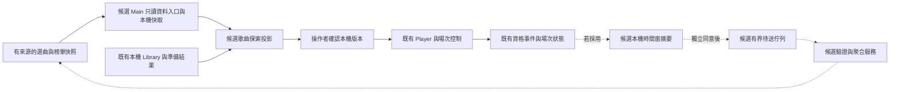

# 串流、KTV 商業模式與 Utawakui 資料架構研究

查核日期：2026-10-26（Asia/Taipei）。本研究接續[歡唱受眾與有限雲端提案](audience-and-optional-cloud-2026-10-26.md)，比較業者出售的價值、內容供應及資料如何支援服務，再提出本案的架構候選。未更改正式定位、收費方式、資料契約或實作狀態；現行承諾見 [PRODUCT](../../../PRODUCT.md)、[spec](../../spec.md)，現行 runtime 見[架構圖](../../architecture.md)。

## 1. 研究結論與證據限制

建議擴大研究居家歡唱、練習與聚會情境，共用本機核心；先建立「歌曲資訊 → 本機素材對應 → 準備狀態 → 演唱操作」的完整路徑。歌曲榜與雲端統計有輔助價值，但目前沒有證據顯示它們能單獨消除素材準備門檻。

以下區分三類內容：來源事實附一手連結；架構與商業取捨是本案推論；樣本規模及容量是實驗假設。沒有訪談、成交資料、業者內部成本或可授權曲庫報價，不能以大型業者收入推估本案營收。官網功能與離線宣稱未經本輪實機驗證。

Spotify 採 2025 年度正式申報；錢櫃採實際讀到的 113 年度（2024）年報，不能稱為 2025／2026 營收。網站價格、曲數、方案與政策會變，本文不建立跨地區價目比較。部分動態頁只讀到入口或比較表，不推論未讀到的方案條款。

## 2. 商業模式比較：出售標的如何影響架構

| 層次／案例                        | 一手來源可確認的模式                                                                                                                                                                                                                                                                                                                  | 對 Utawakui 的啟發與採用界線                                                                                                                 |
| --------------------------------- | ------------------------------------------------------------------------------------------------------------------------------------------------------------------------------------------------------------------------------------------------------------------------------------------------------------------------------------- | -------------------------------------------------------------------------------------------------------------------------------------------- |
| 串流平台：Spotify                 | 2025 年報以 Premium 訂閱與廣告為主要分部；內容權利金、傳輸與付款等形成持續成本。部分授權有最低保證，不全與實際消費量同步。[年報](https://www.sec.gov/Archives/edgar/data/1639920/000162828026006874/ck0001639920-20251231.htm)。                                                                                                      | 推論：曲庫存取、探索、計量與商業權益需分開。訂閱是在支付持續內容／服務，不宜只因本案增加資料庫就照搬；本案也沒有取得該內容供應能力。         |
| 商用系統供應：第一興商／DAM       | 公司區分業務用系統銷售／租賃及歌曲／影像供應，另有 KTV／餐飲店等業務。[事業介紹](https://www.dkkaraoke.co.jp/business/)。                                                                                                                                                                                                             | 推論：設備、內容與現場營運可以分工。可借鏡準備狀態、故障復原、素材品質與控制／呈現分離，不把設備租賃、門市系統或多租戶後台納入目前範圍。     |
| 實體場域：JOYSOUND 店鋪           | 官方區分室料加單杯飲料、含飲料吧等組合；時段、日期、會員與門市會影響費用。[收費結構](https://shop.joysound.com/price/)。                                                                                                                                                                                                              | 推論：顧客在買一段可順暢進行的聚會體驗。應優先降低開唱、換人與換曲摩擦；包廂費／時段收益管理不直接對應本機播放器收費。                       |
| 實體場域：錢櫃                    | 2024 年報的營收分類為銷貨 50.00%、包廂 45.82%、其他 4.18%；同頁列伴唱設備、餐飲及零售等服務。不能把全部銷貨都改稱餐飲。[113 年度年報](https://www.cashboxparty.com/Investment/%E5%B9%B4%E5%A0%B1/2024.pdf#page=53)，PDF 第 53 頁。                                                                                                    | 推論：現場價值跨越曲庫，包含場地與服務。本案適合吸收場次交接、熟悉曲目、聚會選曲等經驗，不推論軟體需要餐飲、會員行銷或消費者追蹤系統。       |
| 家庭歡唱：JOYSOUND for Switch     | 免費下載軟體後購買期間券；官方另列 Switch 月榜，並連向 JOYSOUND 綜合榜。[任天堂產品頁](https://www.nintendo.com/jp/switch/baata/index.html)。                                                                                                                                                                                         | 推論：低頻聚會與長期練習可能有不同使用節奏；各裝置／使用情境的榜單母體也不同。不能由期間券推論本機自備檔案應按時間收費。                     |
| 歌曲服務：KaraFun                 | 個人 Premium 與專業方案用途不同；Business 將有效訂閱綁定 room。其官方另分內容使用權與場地方仍須處理的公開演出權責。[個人／專業說明](https://www.karafun.com/en-ca/subscribe.html)、[Room 訂閱](https://business.karafun.com/helpcenter/room-management_431.html)、[官方權利說明](https://business.karafun.com/en-ca/catalog/rights)。 | 推論：內容、帳號／場地權益與播放器能力應分離。本案未提供商用曲庫或授權代理，不能把其他服務的訂閱搬過來當成本案播放／直播授權。               |
| 資料服務：MusicBrainz／MetaBrainz | 官方區分核心資料 CC0 與補充資料 CC BY-NC-SA 3.0；Hosted API 的非商用與商用方案也有區別。[資料授權](https://musicbrainz.org/doc/About/Data_License)、[API 使用](https://musicbrainz.org/doc/MusicBrainz_API)。                                                                                                                         | 推論：資料的使用條件、資料處理與持續供應服務是不同成本。本案可研究外部身份參照與快取，但不能把所有欄位、標籤、圖片與服務流量統稱免費可商用。 |

同一企業可跨多層；例如第一興商也經營 KTV／餐飲店。因此上表按價值鏈職責比較，不代表各公司只做單一生意。

家庭使用、公開演出與直播應分別核對來源適用範圍。JOYSOUND 的[家庭方案比較](https://living.joysound.com/function/)也另列可配信用途的 STREAMER 產品，顯示同品牌可有不同用途的交付；本輪未讀到 STREAMER 動態官網正文，因此不推論其完整授權範圍。上述是來源揭露與產品分工研究，沒有給出本案可商用／可直播的法律結論。

## 3. 榜單不是單一計數器

Spotify 官方將一般歌曲播放計數的門檻列為至少 30 秒；[榜單說明](https://support.spotify.com/us/artists/article/understanding-spotify-charts/)另指出並非每次播放都進榜，榜單數值可與 App／Artists 統計不同，且榜單過濾不改變其支付權利金的處理。[播放計數說明](https://support.spotify.com/us/artists/article/how-your-streams-are-counted/)。因此本案不應把一個播放次數同時當作個人紀錄、人氣、演唱成果與結算依據，也不照抄 30 秒替換目前的 10 秒 qualification。

JOYSOUND 的[榜單頁](https://www.joysound.com/web/karaoke/ranking)提供綜合、動畫、Vocaloid 等入口並標示統計期間。這能證明歌曲探索與分類的產品價值；本頁沒有提供足夠的原始事件、去重與反濫用規則，不能據此重建其算法或聲稱取得可再散布的資料 API。

| 本案用途     | 建議候選口徑                                                   | 不應宣稱                                     |
| ------------ | -------------------------------------------------------------- | -------------------------------------------- |
| 個人累計播放 | 沿用目前 qualified playback 與本機 playCount。                 | 實際唱完、Mic 驗證或週／月練習次數。         |
| 場次演唱紀錄 | 沿用 occurrence 的開始、完成、略過與中止，另標使用者操作語意。 | 每筆完成都通過音訊辨識、與一般播放完全等價。 |
| 區段練習     | 將重播次數／練習時間視為獨立本機候選，先驗證是否值得保存。     | 每次 A–B 循環都算一次社群人氣。              |
| 社群歌曲熱度 | 在同意範圍內，以有上限的貢獻單位、時間窗及規則版本產生聚合榜。 | 全市場歌曲熱度、獨立自然人人數或不可灌票。   |
| 歌唱評分     | 先完成 Mic、參考旋律與校準研究，獨立決策。                     | 用播放／完成按鈕推算音準或歌手實力。         |

本案現況依[播放紀錄契約](../../contracts/playback-history-and-resume.md)與[場次契約](../../contracts/performance-session-preparation.md)：已有累計次數、最近播放及場次進度；沒有可直接重建所有歷史週榜的完整事件帳。詳細讀取邊界見前份提案，這份研究不修改 owner 或統計語意。

## 4. 應先補上的歌曲與準備狀態模型

建議區分以下概念，先作資料設計，尚未決定新增資料表或 sidecar：

| 概念               | 責任                                                 | 例子與邊界                                                                            |
| ------------------ | ---------------------------------------------------- | ------------------------------------------------------------------------------------- |
| 作品參照           | 描述想唱的作品及共同身份。                           | 同名作品、翻譯標題及 medley 可有歧義；不強迫每首歌都有可信 work ID。                  |
| 錄音／演出版參照   | 指向原唱、翻唱、live、remix 等版本。                 | 不因歌名相同就合併；外部 recording ID 是來源命名空間內的證據。                        |
| 本機素材           | 已存在的 track、音訊、歌詞、分離與處理結果。         | 延續 trackId、filesystem authority 與 main-owned sidecars；不為雲端改寫現有 trackId。 |
| 用途與準備狀態     | 本次能否播放、歌詞是否可讀、伴奏是否就緒及還缺什麼。 | 檔案存在、對時品質、處理就緒及使用者用途確認分開；「可播放」不等於素材權利已確認。    |
| 選曲條目／榜單觀察 | 描述來源、日期、分類與排序。                         | 一首作品可出現在多個榜；只作探索線索，不取代 canonical metadata 或本機可用性。        |

MusicBrainz 官方也區分 [Work](https://musicbrainz.org/doc/Work) 與 [Recording](https://musicbrainz.org/doc/Recording)。可借鏡概念，不必複製完整 schema；既有 [ADR 0015](../../adr/0015-recording-first-provider-discovery.md)已區分來源 URL 與 recording evidence。現有[藝人覆蓋率研究](../metadata/musicbrainz-artist-coverage-2026-10-05.md)只驗證特定 artist 樣本，不能當成作品／版本都能成功對應的證據。

關鍵操作草案：使用者看到榜單歌曲 → 本機找可信對應 → 顯示已準備／可播放但未備妥／沒有素材／對應不確定 → 選擇現有版本或明確進入既有匯入流程 → 加入安排。未知或缺檔項目不能靜默播放別的版本，榜單讀取也不能自動觸發媒體取得。

後續依 Owner 的具體問題補上[音源／影片與 osu! 收藏研究](source-video-osu-collection-2026-10-26.md)：正式音源繼續持有 artist／album 權威，MV 是另外確認的呈現關係；同 video ID 換主機不能保證得到 MV。osu! 可借鏡素材組合、版本與未安裝收藏參照，但不把譜面 set 當正式發行，也不直接採用其儲存或排名方式。

## 5. 候選架構：本機權威、只讀供應與自願貢獻分開

以下是提案，現有架構仍由 architecture／ADR 持有。建議先保持單一桌面核心；雲端若成立，邏輯模組可以共用一個小型部署，不先拆成多個微服務。

| 邊界               | 與當前 owner 的關係                                                 | 採用前要求                                                                                                              |
| ------------------ | ------------------------------------------------------------------- | ----------------------------------------------------------------------------------------------------------------------- |
| 本機曲庫／播放     | Library、usePlayer、Queue／場次及 lyrics 仍是唯一權威。             | 讀榜不更改正在播放的版本、時間、安排或歌詞，不以雲端回應覆寫本機人工校對。                                              |
| 選曲目錄／榜單讀取 | 若採用，另定 Main-owned 外部資料能力及 renderer projection。        | 固定來源／路由、schema／筆數／大小上限、日期／規則版本、快取與過期提示；renderer 不提供任意 URL，Output server 不擴權。 |
| 本機統計           | 延續既有 qualification／persistence；有新時間窗需求才增加有界彙總。 | 不重解釋過去累計數；區分一般播放、場次與練習，清除與缺失資料語意明確。                                                  |
| 自願貢獻           | 獨立用途、同意版本與可停止的待送佇列候選。                          | 不沿用錯誤回報同意；不回補同意前歷史，不傳音訊／歌詞／完整曲庫／路徑；撤銷後取消未送資料，不因延後回應又啟用。          |
| 雲端寫入與聚合     | 與只讀快照分開權限；可以同部署不同 handler。                        | schema 驗證、限量／重試／去重、樣本門檻、保存期限與關閉機制；聚合輸出不能暴露個人時間線。                               |
| 帳號與商業權益     | 本輪不新增；未來若有另外的持續服務，再定其身份與權益。              | 資料貢獻不等於購買、不等於授權素材；付費或帳號失效不能封鎖自備媒體的本機核心。                                          |

現有 `services/feedback-relay` 專門接收預覽後送出的回饋並轉送 Discord，沒有歌曲目錄或分析契約。即使沿用同一家基礎設施，也不應把統計塞入該入口、共用其同意或將回饋訊息當資料倉庫。

跨使用者的「去重、可撤回、匿名」有取捨。可關聯的長期識別碼不自動匿名；若選擇真正無可關聯的聚合，就不能承諾日後可精準刪除某人的所有貢獻。採用前須選定有限身份／保留期限與刪除語意，再設計協定；不在本研究虛構已解決方案。

## 6. 資料來源的產品與使用邊界

Spotify 的[Developer Policy](https://developer.spotify.com/policy)目前列明限制衍生聆聽指標、使用分析與使用者輪廓等用途。這是本案選材時必須核對的來源條件，不能將「API 可讀」直接理解成可以建立並散布自己的平台熱度榜。本輪不建議用 Spotify API 當雲端榜單資料底座，也沒有宣稱所有外部榜都禁止使用。

候選來源分層：

1. 自有編輯選曲：保存編輯、日期、理由與版本；沒有真實統計就明標為選曲清單，避免冷啟動偽造人氣。
2. 外部榜單：先核對來源、更新方式、可保存／展示／再散布範圍與 attribution。未確定時只提供官方連結，不能把網頁抄表視為已取得資料供應權。
3. 共同歌曲身份：優先研究可使用的核心 ID／metadata，逐欄保留來源。MusicBrainz 的標籤、評分與衍生統計屬補充資料，不能沿用核心 CC0 的假設；資料授權也不包含歌曲、歌詞或封面。
4. 本案自願貢獻：只有完成計量與同意設計後才研究聚合榜；資料不是預設可出售的資產，也不宣稱代表未參與者。

[MusicBrainz API](https://musicbrainz.org/doc/MusicBrainz_API)另要求有意義的 User-Agent、每個 client application 至多每秒一次請求，並另列商用方案；不能假定低成本資料授權等於無上限 hosted API。集中式快取需按服務使用條件評估，不能為繞過限制而代理。這裡記錄條件與選材要求，沒有完成合約／個資或跨司法管轄區的法務審查。

## 7. 收入假設與成本：延續已接受方向

既有方向是免費功能核心、可選額外自有外觀 set 個別取得，純支持與作品權益分開；細節見[外觀交付標準](../../governance/appearance-sets-plan.md)。本輪不因 Spotify 訂閱、KTV 期間費或商用 room 計費而改寫這項方向。

| 候選                                     | 適合研究的原因                                               | 尚缺的證據／不先承諾                                                                 |
| ---------------------------------------- | ------------------------------------------------------------ | ------------------------------------------------------------------------------------ |
| 免費本機核心與額外外觀作品               | 延續既定方向，作品收入與交付範圍較清楚。                     | 作品品質、付費意願與產能；不能假設一次作品收入永遠覆蓋雲端成本。                     |
| 小規模只讀選曲服務，由既有支持／預算負擔 | 靜態快照容易快取，可以先驗證使用價值。                       | 明定容量／頻率／維護預算與停止服務的快取降級，不先承諾永久免費或即時榜。             |
| 另有持續價值的可選託管服務               | 若未來真有持續同步、處理或託管需求，才可能形成持續付費理由。 | 獨立產品決策、需求與成本驗證；不把本次榜單研究直接變成訂閱、備份或雲端協作承諾。     |
| 商用場域／維運服務                       | 業者模式顯示設備／內容／營運可分工。                         | 目前沒有門市需求、支援人力或內容供應；先保留研究，不新增 SLA、多房間管理或收費版本。 |

以下是容量情境，全部是假設，不是目前用戶、用量、報價或資料庫選型：

| 假設項                                                                | 計算                                                   | 可觀察的設計影響                                                         |
| --------------------------------------------------------------------- | ------------------------------------------------------ | ------------------------------------------------------------------------ |
| 1,000 個每日參與 client；每個每天最多 20 個歌曲摘要；每筆約 200 bytes | 每天 20,000 筆、約 4 MB 原始 payload；30 天約 120 MB。 | 按天彙總／批次可限制寫入；原始容量未含索引、副本、備份、驗證及濫用流量。 |
| 同一情境每 client 每天一個 batch                                      | 每天 1,000 次正常寫入請求，另加重試。                  | batch 數、單包上限及重試去重，比每個播放動作送 HTTP 更可控。             |
| 10,000 個每日讀者，每天讀取一次約 50 KB 快照                          | 每天約 500 MB、30 天約 15 GB 未壓縮下載。              | 小資料庫不代表沒有流量成本；快取、壓縮與更新頻率要一起估算。             |
| 進入十倍參與／讀取規模                                                | 上述正常流量與容量約十倍，維運不保證線性。             | 先設月預算、告警與降級；未知流量尖峰及客服仍需預留。                     |

成本模型至少包含資料來源／使用條件、請求與驗證、儲存／索引／備份、排程聚合、對外流量、監控與人工處理。待選定區域、服務與保留期限後才查實際價格。盡量先以只讀快照驗證，不為容量表先部署資料庫。

## 8. 可以依序落地的研究切片

| 階段                    | 最小產物                                                                                      | 通過條件                                                                                   |
| ----------------------- | --------------------------------------------------------------------------------------------- | ------------------------------------------------------------------------------------------ |
| A：本機準備與統計小規格 | 既有資料到「可唱版本」的狀態圖；累計播放／場次完成的欄位與用語。                              | 不改 playback authority；未知與缺失不偽造零；播放與演唱區別清楚，保留恢復與清除語意。      |
| B：有來源的選曲清單實驗 | 先自製約 30–50 個已知作品參照，含不同語言、翻唱／live／同名及缺素材案例；預定規模，尚未製作。 | 統計可信對應率、錯配率、人工修正步驟、加入安排成功率與準備時間；不以清單瀏覽量單獨判成功。 |
| C：只讀快照原型         | 有來源／日期／版本的受限資料檔、本機 join 與離線快取；尚未開發。                              | 沒有貢獻也能讀；不自動取得媒體，不替換本機 metadata；過期／來源失效不阻擋開唱。            |
| D：統計協定紙上驗證     | qualification、計數上限、時間桶／時區、撤回／刪除／重試與樣本規則。                           | A–B／BGM／重播不放大人氣；時鐘錯誤、重送、撤銷同意與多裝置案例有可執行預期。               |
| E：有限自願試行         | 只在前階段價值與資料流成立後，另行決定服務／預算／參與者。                                    | 真實樣本足夠再發布社群榜；不足維持選曲清單，不能假造熱度或代表性。                         |

切片 A 延續[逐曲設定、區段練習與對時規劃](player-practice-planning-2026-10-26.md)，不取代目前可靠性／實機驗收優先順序；手機方向仍按原規劃。聚會情境可先用一台主機與既有安排驗證，不先研究旅館／KTV 多房間 SaaS。

## 9. 主要開放決策與後續文件

- 第一個要改善的是「更快開始唱」、「更容易選下一首」還是「看見練習累積」？先以具體任務驗證三者，不直接用 TA 人數或雲端使用量當成果。
- 作品／錄音身份無法可信對應時，允許本機未連結到公共目錄；是否由使用者人工連結，錯配如何撤回？
- 公開社群榜要表達參與 client 的受限播放熱度，還是經明確場次完成的次數？兩者都不能直接命名為真實歌唱人數。
- 資料來源、刪除語意、反濫用與樣本保護能否在單人維運預算內成立？不確定時維持只讀方案。
- 擴大定位是否要正式改寫 PRODUCT，應在研究結果可評審後另作決策；本輪只把發現帶回候選分類。

若採用，先新增 focused product/data contract，再視是否改變 owner／trust boundary 補 ADR 與 architecture。當前沒有任何新的 endpoint、帳號、資料庫、遙控權限、資料上傳、收款或內容授權服務。
