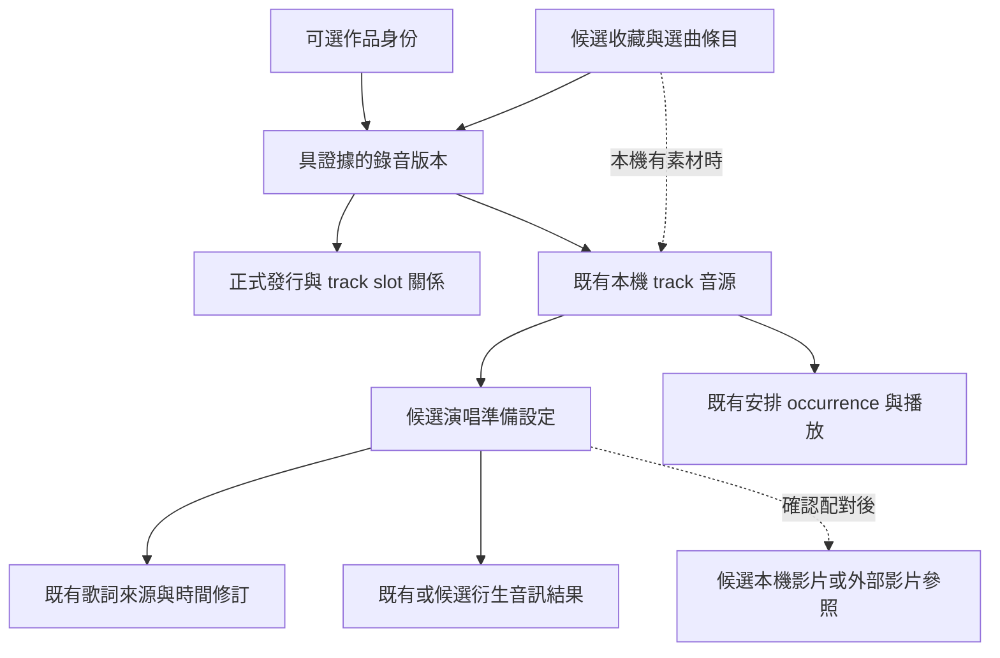

# 音源權威、影片配對、統計與 osu! 收藏架構

查核日期：2026-10-26（Asia/Taipei）。本研究回應 Owner 對正式音源、YT Music／YouTube 同代碼、影片嵌入、榜單計量與 osu! 譜面收藏架構的問題，接續[受眾提案](audience-and-optional-cloud-2026-10-26.md)及[商業模式研究](business-model-and-data-architecture-2026-10-26.md)。本輪只有來源查核與設計候選，沒有影片播放器、外部 iframe、資料遷移、統計上傳或歌曲包格式的實作。

## 1. 目前的音源與專輯權威比網址主機更嚴格

Owner 要保留正式音源對 artist／album 的可靠基礎，這與現有錄音優先及來源專輯設計一致。但「來自 YT Music」本身不是正式錄音的證明。

- [ADR 0015](../../adr/0015-recording-first-provider-discovery.md)及 `electron/lib/importResolver.js` 優先 Songs、Topic／auto-generated 與 official audio，明顯 MV、live、cover、remix 等另行分類。這是有界 metadata 證據及 heuristic，不是官方內容認證。
- 同一檔案也能解析 `music.youtube.com`／`youtube.com` 的 video ID；`electron/lib/youtube.js` 不把換主機視為換了歌曲或另一份影片。
- [來源發行契約](../../contracts/release-source-catalog.md)與 `resources/provider/release_catalog_worker.py` 的自動歸屬更嚴格：原 video ID 必須有 `MUSIC_VIDEO_TYPE_ATV` 證據、唯一 album reference，且正式 audio playlist 必須包含原 ID。Album browse／watch 中替代的 ID 不能直接用來認定本機持有或覆寫來源曲序。
- 本機保存的 track metadata、artist credit 與正式 release membership，不應被後來選用的 MV 標題、上傳頻道或影片時長取代。既有人工校對、[artist 身份](../../adr/0022-artist-identity-and-organization.md)及[曲庫校對](../../contracts/library-reconciliation.md)仍各自持有權威。

因此影片候選應先作為明確關聯的附加呈現來源，不因使用它就新增／改寫音源的 artist、album 或正式發行成員。不同 live／cover 音訊若真的匯入，仍是獨立錄音及其實際演出者，不假裝屬於原唱專輯。

## 2. 同代碼假說：可能本來就是 MV，沒有通用轉換保證

Google 的[Song／Video 說明](https://support.google.com/youtubemusic/answer/6313574?hl=en)確認兩種模式，也明說如果可用來源只有 MV，audio-only 模式仍可能播放該 MV 的音訊。[Art Track 說明](https://support.google.com/youtube/answer/6007071?hl=en)則把 Art Track 定義為錄音與專輯封面的自動生成影片。因此官方音源在 YouTube 上也可呈現為一個影片項目，其內容可能只有封面，不會因換成 YouTube 網址就自動變為拍攝的 MV。

發行商 DistroKid 的[官方說明](https://support.distrokid.com/hc/en-us/articles/29268141694099-Why-Was-My-YouTube-Art-Track-Replaced-with-a-Video)另記錄 YT Music 有時會以相同音訊的 user-uploaded video 替代 Art Track；它可能是 MV、歌詞影片或 live。這可以解釋使用者看到的關聯／替代行為，但沒有提供可保證一對一、同 ID 或同剪輯時間線的公共查詢契約。

本輪公開 metadata 樣本：使用 YouTube 公開 oEmbed，六個已知 ID、九次讀取，全部 HTTP 200；沒有播放、下載音訊／影片、登入或操作 YT Music 的 Song／Video 切換。前三個 ID 同時以兩種 host 的 watch URL 查詢，其餘三個只查 YouTube URL。

| 作品樣本              | Topic 音源項目                                          | 官方 MV 標題項目                                           | 查核範圍                                                                                       |
| --------------------- | ------------------------------------------------------- | ---------------------------------------------------------- | ---------------------------------------------------------------------------------------------- |
| YOASOBI〈アイドル〉   | `m9SMT5ipbxk`，標題「アイドル」，頻道 YOASOBI - Topic。 | `ZRtdQ81jPUQ`，標題含 Official Music Video，頻道 YOASOBI。 | 兩個 ID 各查兩種 host，metadata 各自相同。此處是人工對照，不是自動配對演算法驗收。             |
| YOASOBI〈たぶん〉     | `rgNdeflYdYw`，頻道 YOASOBI - Topic。                   | `8iuLXODzL04`，標題含 Official Music Video，頻道 YOASOBI。 | 音源 ID 查兩種 host，MV 查 YouTube；既有 10-24 來源查核曾觀察到正式 playlist／watch 替代關係。 |
| YOASOBI〈夜に駆ける〉 | `mJ1N7-HyH1A`，頻道 YOASOBI - Topic。                   | `x8VYWazR5mE`，標題含 Official Music Video，頻道 YOASOBI。 | 本輪只查兩個 YouTube URL；既有 10-24 來源查核曾觀察到替代關係。                                |

oEmbed 對 Art Track 與 MV 都回傳 `type=video`，這個欄位不能用來分辨拍攝 MV。以 music URL 提交 oEmbed，也不代表已操作 Music App 或確認其播放模式。公開項目入口例：[音源](https://www.youtube.com/watch?v=m9SMT5ipbxk)、[MV](https://www.youtube.com/watch?v=ZRtdQ81jPUQ)；該組查詢的標題與頻道不同，ID 也不同。

結論：同 ID 可作為同一媒體項目的查核鍵，不能當成「正式音源 → MV」轉換函式。YT Music 內的關聯有研究價值，實際影片須另外保存候選 ID、配對證據、確認者與修訂。六個 ID 都屬同一藝人，樣本不能估計全曲庫可配對率、跨地區可用率、嵌入成功率或時間同步品質。

## 3. 影片功能還有兩個獨立前提

第一是版本與時間線。作品相同或平台列為相關，不代表 MV 使用相同音訊剪輯；片頭、劇情段、重編曲與片尾可能讓單一 offset 不足。候選應區分同剪輯已驗、只需固定偏移、不同剪輯、未確認；音源／影片版本變更後，原同步確認失效。這些是待定模型，不是已實作欄位。

第二是交付方式。YouTube 的[開發者政策 III.I.7–9](https://developers.google.com/youtube/terms/developer-policies)限制拆分／改造影音組件、替影片套用替代音軌與背景播放器等用途，並要求保留播放器功能。因此「官方 embed 靜音，另播本機分離伴奏」不能直接視為已符合該管線的使用條件；是否採用需先解決明確的產品與來源政策適配，不能只因有影片 ID 就承諾 KTV 畫面。

| 路線                 | 可以研究的角色                                 | 尚缺的條件                                                                                                                               |
| -------------------- | ---------------------------------------------- | ---------------------------------------------------------------------------------------------------------------------------------------- |
| 使用者提供的本機影片 | 作為本機音源的附加呈現，依現有音訊時計投影。   | 格式／容量、相同剪輯、offset／多段對應、seek／變速／失敗降級、Main-owned media allowlist 與來源用途確認。                                |
| 官方 YouTube embed   | 保留平台完整播放體驗的外部參考／獨立流程候選。 | 不預設可換成本機伴奏；來源政策、使用情境、播放器 identity、可嵌入性與新 trust boundary 先決策。若改為主播放來源，須另作 authority 決策。 |
| 系統瀏覽器官方連結   | 明確交給外部平台觀看，作配對研究或參考。       | 不宣稱與本機音訊同步，也不把外部播放加入本機演唱次數。                                                                                   |

目前 `index.html` 的 `frame-src` 只允許 loopback，Performer 為 `none`，尚無 YouTube embed。Google 的[IFrame API](https://developers.google.com/youtube/iframe_api_reference)也列出 owner 禁止嵌入、下架／私人與缺少 Referer／client identification（153）等錯誤。oEmbed 成功不證明上述項目能在 Electron 播放；本輪沒有放寬 CSP、攔廣告或注入網頁。

## 4. osu! 值得借鏡的實際結構

後續[本機工作流與引導深入研究](osu-local-first-interaction-and-capabilities-2026-10-26.md)在同一固定 commit 進一步查核首次設定、選曲／空狀態、取得／匯入、帳號權益、更新與復原；本節保留原本的內容身份與收藏結構證據，不作為完整互動規格。

官方 [Beatmap 說明](https://osu.ppy.sh/wiki/en/Beatmap)區分 set 與 difficulties；[`.osz`](<https://osu.ppy.sh/wiki/en/Client/File_formats/osz_(file_format)>)包入譜面及其資源，[`.osu`](<https://osu.ppy.sh/wiki/en/Client/File_formats/osu_(file_format)>)另外描述音訊檔、譜面 metadata 與帶開始時間的影片事件。這是「內容準備包＋使用版本」的參考，不代表本案要成為節奏遊戲。

下列實作判斷固定在 osu!(lazer) commit `4e11ab19feb423c905cf98d9b8fa34700a8aeffa`（2026-10-26），不與 legacy stable 的 Songs 資料夾或 collection.db 混成同一儲存實作。

| osu! 設計與一手程式                                                                                                                                                                             | 可適用的點                                                                           | 不能直接照搬的點                                                                                                 |
| ----------------------------------------------------------------------------------------------------------------------------------------------------------------------------------------------- | ------------------------------------------------------------------------------------ | ---------------------------------------------------------------------------------------------------------------- |
| [BeatmapSetInfo](https://github.com/ppy/osu/blob/4e11ab19feb423c905cf98d9b8fa34700a8aeffa/osu.Game/Beatmaps/BeatmapSetInfo.cs)持有多個 BeatmapInfo 與檔案關聯。                                 | 同一音源可有多套歌詞／排練準備，背景或影片是選用資源；不必為每種呈現複製整首音訊。   | 一個 set 是作者製作的譜面集合，同作品可有多個 set；set ID 不是全球歌曲 ID，也不是正式 album。                    |
| [BeatmapInfo](https://github.com/ppy/osu/blob/4e11ab19feb423c905cf98d9b8fa34700a8aeffa/osu.Game/Beatmaps/BeatmapInfo.cs)區分本機 GUID、OnlineID、內容 hash／線上 hash 與本機修改。              | 分開本機身份、外部參照、內容修訂與同步確認；來源更新不應覆寫人工對時或替換本機音源。 | 譜面內容 hash 不等於歌曲作品／錄音 ID；不能把每次改歌詞、offset 或顯示偏好當成一首新歌。                         |
| [BeatmapCollection](https://github.com/ppy/osu/blob/4e11ab19feb423c905cf98d9b8fa34700a8aeffa/osu.Game/Collections/BeatmapCollection.cs)保存譜面 hash 參照，允許未安裝／已移除項目仍留在收藏中。 | 「想唱／收藏／榜單曲目」可先有參照，本機是否已持有另表示；適合探索清單與缺曲提示。   | 本案 `library.json` 不建立假 track，既有 playlists 與來源 album 契約也不直接改成任意 hash 清單。                 |
| [RealmFileStore](https://github.com/ppy/osu/blob/4e11ab19feb423c905cf98d9b8fa34700a8aeffa/osu.Game/Database/RealmFileStore.cs)依內容 hash 保存／重用檔案，清理時檢查引用。                      | 若未來確有跨準備包共用大型素材，刪除／清理須先核對引用與原始素材保留。               | 本案目前以 tracks／trackId 與 filesystem authority 運作；不為概念相似就遷移 Realm、全域 CAS 或導入相同刪除策略。 |

收藏更新也有代價：該版 BeatmapInfo 的 `TransferCollectionReferences` 處理內容 hash 改變後的收藏遷移。這提醒本案要把穩定參照與內容修訂分開；不能只見 hash 去重方便，就忽略更新、人工修改與引用復原。

## 5. 對本案較適合的關係模型

以下是邏輯關係草案，不是新增的正式資料表、檔案格式或既有 owner 替代品：

採用前建議固定五項原則：

1. 正式 artist／album 繼續沿音源與來源發行證據；影片 title／uploader 不進來稀釋 canonical metadata。
2. 歌詞、伴奏、逐曲演唱設定與影片配對是關聯／修訂；分離結果、轉調 cache 不成為新錄音身份。不同真正錄音仍保留獨立版本。
3. 想唱／榜單參照與本機持有分開。來源 catalog 已有缺曲 slot／持有對照，可借鏡這種分工，不再製造平行假曲庫。
4. 準備組合能被檢查、套用、失效及恢復；不先建立整包社群下載格式。若日後研究分享，metadata、歌詞、音訊、影片及外觀作品的可散布範圍分別處理。
5. Local Player 是現有時間權威。適用的本機附加呈現由它驅動，音訊不等待影片或網路；影片失效回復靜態畫面，不反向污染安排、歌詞或一般播放紀錄。官方 embed 的獨立播放流程另議。

## 6. 榜單「只算正式音源」需要先定榜的對象

外部榜並非都只計專輯音源：Google 的[YouTube Charts 說明](https://support.google.com/youtube/answer/9014376?hl=en)明列 Weekly Top Songs 會合併官方 MV、帶有官方歌曲的使用者影片與歌詞影片；Top Music Videos 則是另一種榜。不能把它們重新命名成「純正式音源播放榜」。來源榜的方法與本案錄音分類／統計方法須分開保存。

本案的建議是先保護正式音源的選曲與分類精準度，再決定是否需要更廣的作品榜：

| 本案用途             | 建議候選範圍                                                         | 影片／其他版本如何處理                                                                             |
| -------------------- | -------------------------------------------------------------------- | -------------------------------------------------------------------------------------------------- |
| 正式音源選曲／版本榜 | 只納入有可信錄音與正式來源證據的參照；不是只看 URL 是否 music host。 | 可附已確認 MV，仍指向原音源；不把 MV 點播另加一次音源使用，不合併 live／cover。                    |
| 個人本機使用紀錄     | 保留使用者實際播放的本機版本，沿既有 qualification。                 | 非正式音源也能有本機紀錄；未知版本不假裝已認證，不為了榜單刪掉使用者正常使用。                     |
| 社群作品熱度         | 另定可信作品關聯、計數與版本維度後才做。                             | MV 僅作附加呈現時不增加事件；不同 live／cover 若納入，須保留歸屬與可分開檢視，未知配對不強行合併。 |
| 歌唱成績榜           | 保持獨立、低優先。                                                   | 不以播放來源、收藏狀態或正式音源分類取代 Mic／評分校準。                                           |

osu! 的譜面狀態與排行榜提供另一個啟發：內容可在本機使用，是否進某類線上榜是另一項資格。這不代表本案採用 Ranked／Loved 流程，更不代表任何審核狀態能保證音樂授權。

## 7. 下一輪值得做的有界驗證

- 先擴大正式音源／MV 樣本到不同藝人、語言、無 MV、同名、live、長劇情 MV、地區不可用與下架案例；保存配對證據、版本、時長及失敗，不從三個同藝人樣本推通用率。
- 來源關聯查核與嵌入可用性分開。只有官方 embed 用途與政策適配先成立，才研究 isolated surface、Referer、事件與錯誤；不為測試先改 production CSP。
- 如選本機影片路線，以使用者明確提供且用途適當的素材驗證同剪輯／固定 offset／多段不同步、seek／tempo／ended 與失訊降級；目前沒有跑這些測試。
- 將「一個本機音源＋兩套歌詞／演唱偏好＋可選影片」寫成小規格，驗證保存、切換、刪除與來源改版，不先重構全曲庫。
- 為正式音源榜另定可信資格與同次播放去重；用相同音源的不同準備設定測試不重複計數。未知身份維持明示，不視為零或錯誤內容。

本輪原始 oEmbed 收據與舊來源查核的識別資訊保存在本機 tasks；本頁保存公開樣本及限制。osu! 僅閱讀上述固定 commit 與官方格式文件，沒有執行遊戲、匯入譜面或複製媒體。所有提案仍待 focused contract／必要 ADR 與產品決策，不更改現在的資料所有權或功能 gate。
